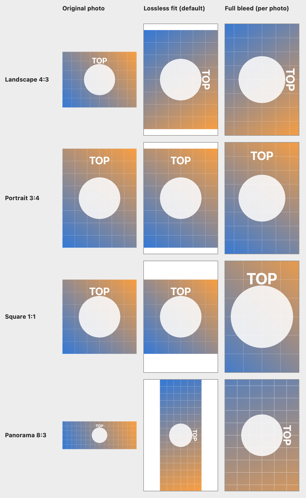

# Borderless Photo Print

A small macOS app for printing 4×6 inch photos borderless, in bulk, without losing parts of the picture
by accident and with a live view of what the printer is actually doing.

Drop in photos, press Print. Each photo is laid out on the sheet by the app itself:

- **Lossless fit (default).** The app tries the photo upright and sideways on the portrait 4×6 sheet and
  keeps the orientation that prints larger. Nothing is cropped; if the shape does not match, white
  margins remain.
- **Full bleed, per photo.** One click on a photo's crop button fills the whole sheet and crops the
  overflow, for that photo only. Click again to go back.
- **Honest preview.** Each thumbnail is the sheet as it will print, margins and crop included.
- **Per-photo control.** Rotate left/right, toggle full bleed, or print just that one photo.
- **Queue tracking.** Every photo shows its real state: sending, queued (with its place in line),
  printing, printed, failed or canceled, plus a summary line. "Cancel pending" cancels only the jobs
  this app sent, and "Print" never re-sends photos that are already in the queue.



The figure is generated by this repository's own layout code from synthetic images
(`tools/demo/main.swift`).

## Build

Requires macOS and the Xcode command line tools (`xcode-select --install`).

```sh
./build.sh
open "build/Fotoğraf Çıktı.app"
```

The script compiles `Sources/*.swift` with `swiftc` and ad-hoc signs the bundle. Move the app to
`/Applications` or `~/Applications` if you want to keep it. To regenerate the figure:

```sh
swiftc -O tools/demo/main.swift Sources/PageLayout.swift -o build/demo && build/demo docs/layout.png
```

## How it works

The app talks to CUPS through the standard `lp`, `lpstat` and `cancel` tools. For each photo it
renders a finished 2400×3600 px (600 dpi) sheet to a temporary JPEG, sends it with the borderless
`4x6.Fullbleed` page size, and then polls `lpstat` every two seconds to map each job to a state.

The layout is done in the app rather than through CUPS scaling options on purpose. With the CUPS
filter used by the HP Smart Tank 580/590 PPD I developed against, running `cupsfilter` on a 3:4 photo
with `print-scaling=fit` and `print-scaling=fill` produced the same page, so those options could not be
relied on there. I did not test other printers or filters.

| File | Role |
| --- | --- |
| `Sources/main.swift` | SwiftUI interface, printer and paper selection, job submission |
| `Sources/PageLayout.swift` | Orientation choice, rotation and the sheet layout |
| `Sources/JobStatus.swift` | Parsing `lp` / `lpstat` output into per-photo states |

## Printer notes

- Developed against an HP Smart Tank 580/590 series printer. The paper types in `paperTypes`
  (`Sources/main.swift`) use that printer's CUPS media names (`photographic-glossy`,
  `com.hp-specialty-glossy`, `com.hp-matte-inkjet`). For another printer, list your options with
  `lpoptions -p <printer> -l` and edit the table.
- The page size is fixed at 4×6 inch. The printer must offer a borderless `4x6.Fullbleed` size.
- The system default printer is selected at launch; you can change it in the window.
- "Printed" means CUPS reports the job as completed successfully. It cannot see a paper jam or an
  empty tray.
- The interface text is currently Turkish only.
- I have only built it on macOS 27 (Apple silicon). `Info.plist` declares macOS 13 as the minimum, which I
  have not verified.

## Author

Tarık İsmet ALKAN — [GitHub @tialkan](https://github.com/tialkan) · [X @tialkan](https://x.com/tialkan)

## License

[MIT](LICENSE)
